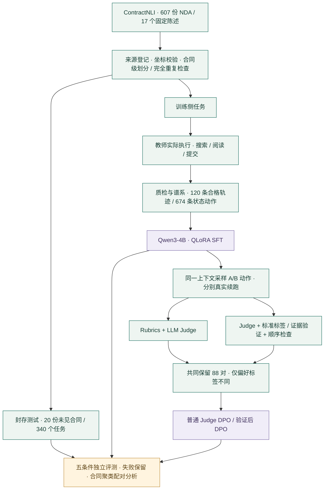
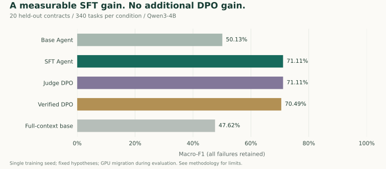

<div align="center">

# ContractAgent-Align

**法律场景的 Agent 训练数据生产、质量评估与偏好对齐**

Structured Data · Rubrics · LLM-as-a-Judge · SFT / DPO · Independent Evaluation

[](https://github.com/henzxu5-rgb/ContractAgent-Align/actions/workflows/tests.yml)


[快速体验](#快速体验) · [实验结果](#实验结果) · [方法与边界](docs/METHODOLOGY.md) · [数据 SOP](contract_agent/SOP.md) · [复现说明](docs/REPRODUCE.md)

</div>

将英文保密协议核查适配为可执行的工具任务，完成 **示范采样 → 数据质检 → SFT → 偏好标注 → DPO → 独立评测** 的实际闭环。关注一个可检验的问题：**同一候选池中，加入标签与证据验证的偏好标注，能否比直接使用 LLM Judge 更有利于模型训练？**

**本轮结果：SFT 的 Macro-F1 提高 20.98 个百分点；DPO 未显示额外收益。** 完整保留失败、拒判、训练记录和逐例结果，质量检查与最终效果分别报告。

## 数据与实验流程



参考标注只用于执行后的训练侧质检与评测。行动模型只看到当前合同、陈述和工具观察；搜索不到不能直接证明“合同未提及”。

## 实际交付

| 模块 | 实现与可检查材料 |
|---|---|
| 结构化数据生产 | 执行 236 个教师任务，筛选 120 条轨迹，导出 674 条状态动作；记录来源、模型与筛选结果 |
| Agent 环境 | BM25 `search_contract`、`read_spans`、`submit_result`；最多六次读取/检索；引用必须实际观察过 |
| Rubrics 与 Judge | 检查标签、证据、工具行为及冗余调用；保存 A/B、交换顺序、平局、拒判及核验依据 |
| 偏好数据质检 | 400 对自然候选 → 88 对共同偏好；65 对工具行为差异，17 对偏好标签差异 |
| 模型训练 | 同一 Qwen3-4B、NF4 QLoRA；SFT 86 次有效更新，两组动作级 DPO 各 6 次；校验参考模型冻结与适配器重载 |
| Benchmark 适配与分析 | 五条件 × 340 任务 = 1,700 条测试执行；Macro-F1、证据 F1、执行错误与合同聚类 bootstrap |
| 回放与 SOP | 原文定位、实际轨迹、同上下文偏好回放；数据卡、处理流程、失败分析与复现说明 |

## 实验结果



| 条件 | Macro-F1 | 证据 F1 | 完成提交 |
|---|---:|---:|---:|
| 基础 Agent | 50.13% | 42.32% | 295 / 340 |
| **SFT Agent** | **71.11%** | 62.29% | **340 / 340** |
| 普通 Judge DPO | 71.11% | 63.47% | 340 / 340 |
| 验证后 DPO | 70.49% | **63.84%** | 340 / 340 |
| 基础模型全文回答 | 47.62% | 54.91% | 316 / 340 |

- SFT 相对基础 Agent 的 Macro-F1 差值为 **+20.98 个百分点**，按合同聚类的配对 95% bootstrap 区间为 **[+14.83, +27.63]** 个百分点。提升包含协议遵循和提交完成率的改善。
- 验证后 DPO 相对 SFT 为 **−0.61** 个百分点，相对普通 Judge DPO 为 **−0.62** 个百分点；两项差异区间均跨零，未达到预设继续门槛。
- 证据分数仅统计参考支持/反驳任务；所有失败保留在主结果。全文基线允许更长输入，本轮没有显式输入溢出失败。

[完整报告](contract_agent/artifacts/reports/FINAL_REPORT.md) · [机器可读结果](contract_agent/artifacts/reports/final_results.json) · [逐例分析](contract_agent/artifacts/reports/per_case_analysis.jsonl) · [Judge 数据审计](contract_agent/artifacts/reports/PREFERENCE_AUDIT.md)

## 快速体验

Python 3.11。仓库附带处理后的公开数据与真实执行记录；只读回放不需要 GPU、模型下载或 API 密钥。

```bash
git clone https://github.com/henzxu5-rgb/ContractAgent-Align.git
cd ContractAgent-Align
python -m venv .venv
# Linux / macOS: source .venv/bin/activate
# Windows PowerShell: .venv\Scripts\Activate.ps1
python -m pip install -r contract_agent/requirements-local.txt
python -m contract_agent.server --port 8766
```

打开 **http://127.0.0.1:8766**，选择测试批次查看合同原文、实际调用与最终提交；下方可查看完整 400 对候选及拒判理由。页面同时呈现训练参考标注，属于执行后的回放。

```bash
# 离线检查；使用临时数据和测试替身，不调用模型
python -m unittest discover -s contract_agent/tests -q
# 从保存的测试执行重新计算主指标，不进行推理
python tools/verify_public_results.py
```

训练与重新推理另需 CUDA 环境、固定基础模型及相应适配器，见[复现说明](docs/REPRODUCE.md)。模型大权重保留在本地交付中，仓库公布版本、权重校验值及训练记录。

## 阅读路线

| 想看什么 | 从这里开始 |
|---|---|
| 任务、比较设计和限制 | [方法说明](docs/METHODOLOGY.md) |
| 数据来源、许可与标注边界 | [数据卡](contract_agent/DATA_CARD.md) |
| 数据处理、Rubrics 和质检步骤 | [SOP](contract_agent/SOP.md) |
| Agent 如何实际执行 | [environment.py](contract_agent/environment.py) · [runner.py](contract_agent/runner.py) |
| 怎样生成与核验偏好 | [preferences.py](contract_agent/preferences.py) · [preference_jobs.py](contract_agent/preference_jobs.py) |
| 怎样做训练和评测 | [training.py](contract_agent/training.py) · [scoring.py](contract_agent/scoring.py) · [analysis.py](contract_agent/analysis.py) |
| 原始配置与训练验收 | [训练记录](contract_agent/artifacts/training_logs) · [DPO 两组完整性检查](contract_agent/artifacts/reports/dpo-arms-integrity.json) |

## 范围与来源

这是 **ContractNLI 的工具交互适配实验**。原数据由研究者与众包人员标注，本项目未新增法律专家审核。17 个固定陈述、20 份测试合同、单次训练种子及评测期间的 GPU 迁移限制结论；公开数据的预训练污染不能排除。详见[方法说明](docs/METHODOLOGY.md)。

AI 偏好 DPO 属于模型反馈对齐实践；本项目未实现 PPO-RLHF，也不主张已实现自主自进化、通用法律咨询或官方 Agent 榜单成绩。开发与实验执行使用了 AI 编程工具辅助。

源码采用 [MIT](LICENSE)。原始 ContractNLI 及保留其内容的派生数据遵循来源署名与 CC BY 4.0 要求，见 [第三方说明](THIRD_PARTY_NOTICES.md)。

> Yuta Koreeda and Christopher D. Manning. 2021. [ContractNLI: A Dataset for Document-level Natural Language Inference for Contracts](https://aclanthology.org/2021.findings-emnlp.164/). Findings of EMNLP.
