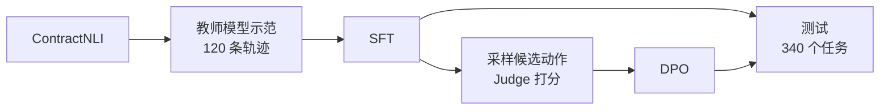

# ContractAgent-Align

用公开的合同数据集 ContractNLI 做的一个小实验：让 Qwen3-4B 在保密协议里查找证据、判断陈述，再试试 SFT 和 DPO 能不能把它训练得更好。

## 任务

每个任务给一份保密协议（NDA）和一条陈述，比如"归还或销毁机密信息后，接收方仍可保留其中一部分"。模型要判断合同是支持、反驳还是没提到这件事，并指出依据的原文片段。

模型看不到全文，只能用三个工具：搜索合同、读取片段、提交答案。每个任务最多调用 6 次，引用的片段必须是自己读过的。

## 流程



1. 用更强的模型先把训练任务做一遍，留下答对的 120 条记录，拆成 674 条样本做 SFT。
2. 让 SFT 后的模型在同一步生成两个不同动作，各自做完任务，再让 LLM 按评分标准（Rubrics）判断哪个更好。
3. 偏好数据分两组：一组只听 Judge 的，一组再用标准答案核对一遍。两组各训练一个 DPO 模型。
4. 在 20 份没见过的合同（340 个任务）上测试所有模型。

## 结果

| 模型 | Macro-F1 | 证据 F1 | 完成提交 |
|---|---:|---:|---:|
| 基础模型 | 50.13% | 42.32% | 295 / 340 |
| SFT | 71.11% | 62.29% | 340 / 340 |
| DPO（只用 Judge） | 71.11% | 63.47% | 340 / 340 |
| DPO（Judge + 核对） | 70.49% | 63.84% | 340 / 340 |
| 基础模型直接读全文 | 47.62% | 54.91% | 316 / 340 |

SFT 提升了大约 21 个点，其中有一部分是因为模型学会了按格式提交答案。DPO 基本没有变化，两种偏好数据之间也看不出差别。

DPO 没效果，主要是数据太少。400 对候选里大部分没有分出明确的好坏，最后两组只有 88 对可用、其中只有 17 对不一样，训练也只有 6 步。另外 ContractNLI 的标准证据不一定全，拿它来核对 Judge 本身也可能有偏差。

详细结果见[实验报告](contract_agent/artifacts/reports/FINAL_REPORT.md)，实验设计和局限见[方法说明](docs/METHODOLOGY.md)，数据处理步骤见 [SOP](contract_agent/SOP.md)。

## 局限

- 测试集只有 20 份合同，只训练了一次，结果不一定稳定。
- 偏好全部来自 LLM，没有人工标注。
- 测试中途换过一次 GPU。

## 运行

仓库里保存了数据和所有测试记录，下面这些不需要 GPU：

```bash
pip install -r contract_agent/requirements-local.txt
python -m unittest discover -s contract_agent/tests -q   # 测试
python tools/verify_public_results.py                    # 用保存的记录重新算分
python -m contract_agent.server --port 8766              # 打开本地页面查看每条记录
```

重新训练需要 GPU，见[复现说明](docs/REPRODUCE.md)。

## 说明

代码和实验主要借助 Codex 和 Claude Code 完成。

代码使用 [MIT](LICENSE) 许可。ContractNLI 数据遵循 CC BY 4.0，见[第三方说明](THIRD_PARTY_NOTICES.md)。

> Yuta Koreeda and Christopher D. Manning. 2021. [ContractNLI: A Dataset for Document-level Natural Language Inference for Contracts](https://aclanthology.org/2021.findings-emnlp.164/). Findings of EMNLP.
